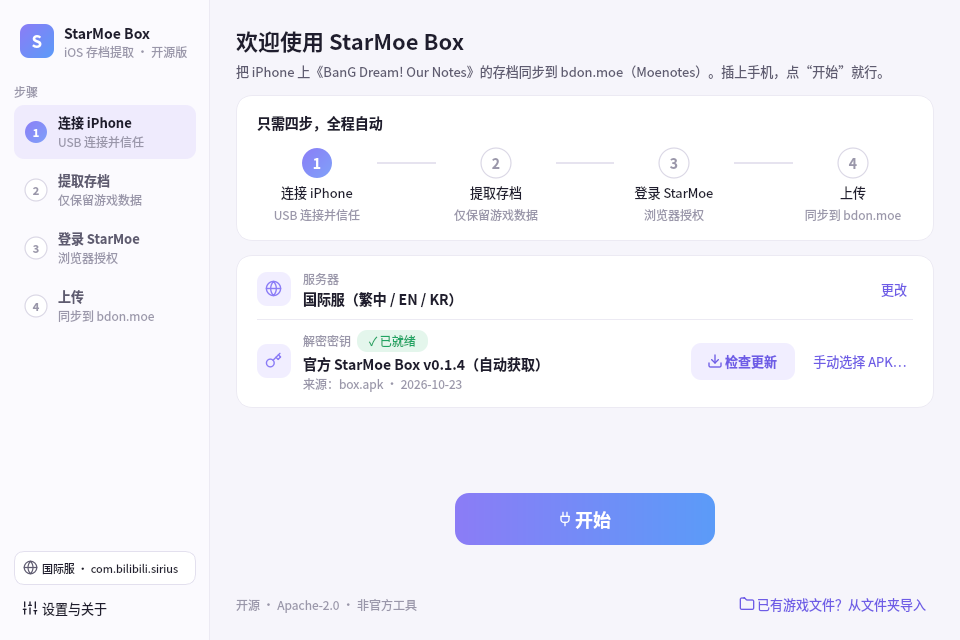
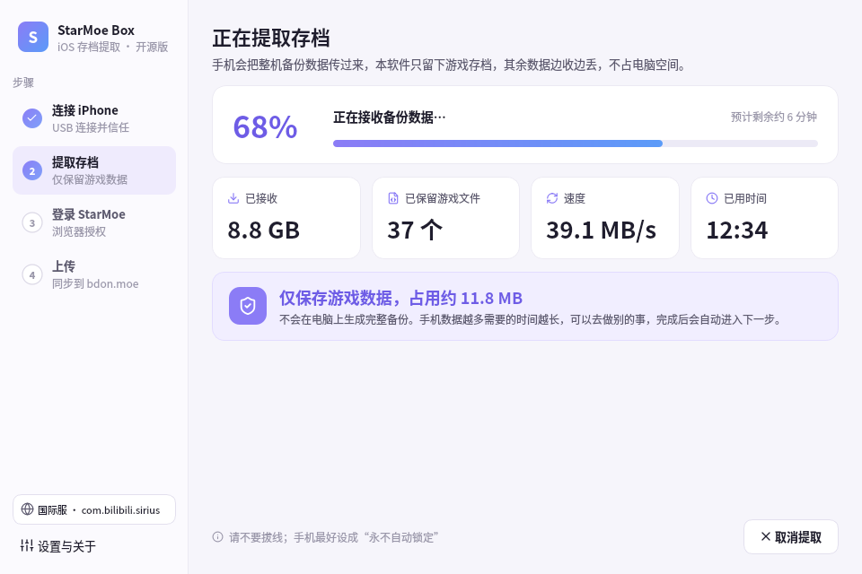
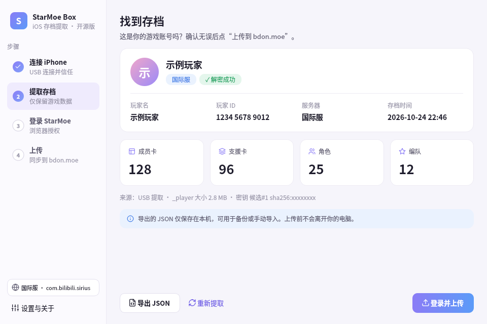

# StarMoe Box（iOS 桌面版）

在 **macOS / Windows** 上，从用数据线连接的 **iPhone** 中提取 **BanG Dream! Our Notes**
（国际服「BanG Dream! 交織的樂章」/ 日服「バンドリ！アワーノーツ」）的存档，一键上传到 StarMoe 通行证，
再到 [bdon.moe 组卡](https://bdon.moe/tools/deck) 导入。是安卓版 [StarMoe Box](https://github.com/StarMoe-org/StarMoe-box) 的 iOS 对应工具。

## 🚀 小白教程：三步搞定

**① 下载** —— 打开 [Releases 页面](https://github.com/MisakaZhu/starmoe-box-ios/releases/latest)，按电脑选一个：

| 你的电脑 | 下载这个 |
| --- | --- |
| Mac（M1/M2/M3/M4 等 Apple 芯片） | `StarMoeBox-mac-arm64.dmg` |
| Mac（Intel 芯片） | `StarMoeBox-mac-x64.dmg` |
| Windows 10 / 11 | `StarMoeBox-Setup.exe` |

> 不知道 Mac 是哪种芯片？点屏幕左上角  › 关于本机，“芯片”写着 Apple M… 就选 arm64，写着 Intel 就选 x64。

**② 安装 / 打开**

- **Mac**：双击 `.dmg`，把 **StarMoe Box** 图标拖到右边的「应用程序」文件夹，然后在「应用程序」里打开它。
  - 如果提示“无法验证开发者”/“Apple 无法检查其是否包含恶意软件”：在「应用程序」里 **右键点 StarMoe Box › 打开 › 打开**
    （macOS 15 起：先双击一次，再到「系统设置 › 隐私与安全性」最下面点 **仍要打开**）。只需要做一次。
    已经过 Apple 公证的版本不会出现这个提示。
- **Windows**：双击 `StarMoeBox-Setup.exe` 一路“下一步”（不需要管理员权限）。
  - 如果蓝色窗口提示“Windows 已保护你的电脑”：点 **更多信息 › 仍要运行**。
  - 安装程序会检查电脑有没有 **Apple Devices**（Apple 的 iPhone 驱动）。没有的话，按提示在 Microsoft Store 里免费安装一下
    （装过 iTunes 也行）。

**③ 插手机，点「开始」**

用数据线连上 iPhone 并解锁，手机弹出“要信任此电脑吗？”时点 **信任**。回到 StarMoe Box 点大大的 **开始**，然后一路跟着走：

1. 第一次使用会询问是否从 GitHub 自动获取解密密钥 —— 点 **同意并自动获取**（约 1.4 MB，几秒钟）。
2. 检测到手机后 3 秒自动开始提取（期间保持亮屏、别拔线；万一断了会自动续传）。
3. 看到“找到存档”和你的玩家名后，点 **登录并上传**，在浏览器里登录 StarMoe 通行证 → 自动跳回并上传。
4. 显示“上传成功”，点「去 bdon.moe 导入」即可。

| 开始 | 提取中 | 找到存档 |
| --- | --- | --- |
|  |  |  |

### 常见问题

| 问题 | 怎么办 |
| --- | --- |
| **提示“无法连接 GitHub”/ 密钥下载失败** | 国内网络偶尔连不上 GitHub。稍后点「自动获取密钥」重试（会自动断点续传）；或者用别的方式下载官方 [StarMoe Box 安卓版 `app-release.apk`](https://github.com/StarMoe-org/StarMoe-box/releases/latest)，点「手动选择 APK…」选它。本软件不使用第三方镜像。 |
| 一直“正在寻找 iPhone” | 换根数据线 / 换个 USB 口，解锁手机，点“信任”。Windows 确认装了 Apple Devices（或 iTunes），装完后重启一次电脑。 |
| 要输入“备份密码” | 你以前在 iTunes/Finder 里开过“加密本地备份”。输入当时设置的备份密码（不是锁屏密码）。忘了的话只能在手机上「设置 › 通用 › 传输或还原 iPhone › 还原 › 还原所有设置」清除，会重置设置项，慎用。 |
| 提取很慢 | 手机会把全部数据流过一遍（电脑只保存游戏的十几 MB），几百 GB 的手机可能要一两个小时。请保持亮屏（把「自动锁定」设为「永不」）。 |
| 中途拔线 / 锁屏了 | 插回去解锁就行，会自动重试；如果游戏文件已经收到会直接解析，不用重来。 |
| 提示“解密失败” | 软件会自动检查官方是否发布了新版密钥并重试。仍失败的话，到「设置与关于」点「自动获取」或手动选择最新版官方 APK。 |
| 想换日服 | 开始页「服务器」那一行点「更改」，选「日服」。软件会记住你的选择。 |
| 已经有备份 / 游戏文件 | 开始页底部点「已有游戏文件？从文件夹导入」，选 iTunes/Finder 备份目录或拷出来的游戏文件夹。 |
| 登录后浏览器没跳回来 | 在登录页点「浏览器没有跳回来？手动粘贴回调地址」，把浏览器地址栏里 `moe.starmoe.box://` 开头的地址粘进去。 |
| 安全吗？ | 存档只上传到你自己的 StarMoe 通行证账号；密码、令牌不会写进日志；解密密钥在本机运行时从官方安装包读取，不随本软件分发。软件开源，可以自己检查。 |

日志位置：macOS `~/Library/Logs/StarMoeBox/`，Windows `%LOCALAPPDATA%\StarMoeBox\logs\`（「设置与关于 › 打开目录」）。
反馈问题请到 [Issues](https://github.com/MisakaZhu/starmoe-box-ios/issues)，附上日志（不含密码、令牌和密钥）。

---

## 一、功能说明

- **不需要整机备份**：手机照常通过 USB 发送备份数据流，本软件只把游戏自己的文件写到硬盘（约十几 MB），其余即收即弃。
  1TB 的 iPhone 配 256GB 的电脑也没问题。
- **断线自动续传**：数据线松动、手机锁屏导致中断时，会自动重新检测设备并重试（默认最多 5 次）；
  如果游戏文件在中断前已经收到，会直接解析，不必再传一遍。
- **自动获取密钥，不分发密钥**：经你同意后，从 GitHub 上官方仓库 `StarMoe-org/StarMoe-box` 的最新 Release 下载
  `app-release.apk`（只接受 github.com 及其官方下载域名、HTTPS，校验 GitHub 提供的 sha256），缓存在本机数据目录，
  运行时从中读取密钥。密钥不随本软件分发、不写入仓库、不上传。官方发新版（密钥可能轮换）时会自动跟进；解密失败也会自动重新检查一次。
  也可以手动选择 APK 或 `{"key":"…","magic":"…"}` 密钥文件。
- 默认国际服，可在开始页切换，软件会记住。
- 开源（Apache-2.0）· 非官方工具，与 Bushiroad、bilibili 及 StarMoe 官方无关。

| 区服 | iOS Bundle ID | 上传为 |
| --- | --- | --- |
| 国际服（繁中/EN/KR） | `com.bilibili.sirius` | `intl` |
| 日服 | `com.bushiroad.sirius` | `jp` |

---

## 二、给开发者

### 从源码运行
```bash
python3 -m venv venv
venv/bin/pip install -r requirements.txt -r requirements-gui.txt    # Windows: venv\Scripts\pip
venv/bin/python -m starmoe_ios.gui                                 # 图形界面
venv/bin/python -m starmoe_ios --help                              # 命令行
```
从源码运行时：Windows 会把 `moe.starmoe.box://` 注册为 `pythonw packaging\entry.py`；Linux 写入 `.desktop` 并调用 `xdg-mime`；
macOS 只有打包后的 .app（Info.plist 中声明 `CFBundleURLTypes`）才能接收回调，源码运行请用“手动粘贴回调地址”。

### 目录结构
```
starmoe_ios/
  savecodec.py rijndael.py   存档格式与解密（Codec.load：密钥文件 > 环境变量 > APK）
  backup.py                  iTunes/Finder 备份读取（含加密备份）
  device.py                  usbmux 设备检测、过滤备份（mobilebackup2）
  core.py                    扫描/选择存档、统计信息 —— CLI 与 GUI 共用
  keyfetch.py                从 GitHub 官方 Release 自动下载 StarMoe Box APK（主机白名单、sha256 校验、断点续传、缓存）
  winsupport.py              Windows：检测 Apple 设备支持（Apple Devices / iTunes）
  api.py                     StarMoe 通行证 PKCE 登录、刷新令牌、上传
  errors.py                  错误码（ERR_NO_DEVICE / ERR_DECRYPT / ERR_AUTH_EXPIRED …）
  cli.py                     命令行
  gui/                       PySide6 图形界面
    app.py                   主窗口、流程控制、单实例 + URL 回调（QLocalServer / QFileOpenEvent）
    pages.py                 各步骤页面        settings_dialog.py  设置与关于
    workers.py               后台线程（过滤备份 + 自动重试 + 断线后抢救解析）
    auth.py                  令牌存储（keyring）、URL Scheme 注册
    theme.py widgets.py      样式、图标（Lucide）、通用控件
packaging/                   PyInstaller 配置、构建脚本、图标
  macos/entitlements.plist   hardened runtime 例外      windows/StarMoeBox.iss  Inno Setup 安装包脚本
tests/                       test_all.py（格式/扫描）、test_keyfetch.py（自动获取密钥，离线模拟）、
                             test_gui.py（GUI 逻辑）、render_screenshots.py（截图）
```

### 测试
```bash
PYTHONPATH=. python tests/test_all.py
PYTHONPATH=. python tests/test_keyfetch.py     # 模拟 GitHub：主机/仓库校验、sha256 不符、API 不可用走直链、用缓存、断点续传
QT_QPA_PLATFORM=offscreen PYTHONPATH=. python tests/test_gui.py          # 断线重试、抢救、取消、令牌、回调、自动密钥、解密失败重取、自动上传
QT_QPA_PLATFORM=offscreen PYTHONPATH=. python tests/render_screenshots.py \
    --apk app-release.apk --folder <游戏文件夹> --out screenshots          # 渲染所有页面
```
测试不会连接设备、不会联网、不会上传。公开截图一律使用示例数据；给了 `--folder` 时会额外用真实存档验证一遍，
真实结果截图只写到 `screenshots/private/`（已在 `.gitignore` 中排除，**不要提交**）。

### 打包（一键安装包）
| 平台 | 命令 | 产物 |
| --- | --- | --- |
| macOS | `bash packaging/build_mac.sh` | `dist/StarMoeBox-mac-arm64.dmg` 或 `dist/StarMoeBox-mac-x64.dmg`（按构建机架构） |
| Windows | `powershell -ExecutionPolicy Bypass -File packaging\build_windows.ps1` | `dist\StarMoeBox-Setup.exe` |

- **macOS**：PyInstaller onedir + BUNDLE（`argv_emulation=False`，Info.plist 含 `CFBundleURLTypes`），然后做 DMG：
  有 [`create-dmg`](https://github.com/create-dmg/create-dmg)（`brew install create-dmg`）时生成带背景图和「应用程序」快捷方式的拖拽安装窗口，
  否则用 `hdiutil` 生成带 `/Applications` 链接的 UDZO 镜像。arm64 与 x64 分别在对应架构的机器上构建（不做 universal2）。
  没有证书时 ad-hoc 签名；有证书时见下方「macOS 签名与公证」。
- **Windows**：PyInstaller onedir（`dist\StarMoeBox\`，设 `STARMOE_ONEFILE=1` 可改为单文件），再用 Inno Setup 6
  （`packaging/windows/StarMoeBox.iss`）打成安装包：按用户安装到 `%LOCALAPPDATA%\Programs\StarMoe Box`、无需管理员；
  开始菜单 + 可选桌面快捷方式；安装时在 `HKCU\Software\Classes\moe.starmoe.box` 注册登录回调协议，卸载时删除；
  检测 Apple Devices / iTunes（Apple Mobile Device Support），没有时显示引导页，并在完成页提供“打开 Microsoft Store”。
  软件第一次进入“连接 iPhone”时也会再检查一次（usbmuxd 端口 27015 / 服务 / Store 应用 / iTunes 注册表），缺少时显示安装引导页。
- 打包后可运行 `StarMoeBox --selftest` 检查依赖是否完整（结果写入日志目录 `selftest.txt`）。
- 图标与 DMG 背景：`python packaging/make_icons.py` 重新生成 `packaging/icons/`。
- **GitHub Actions**（`.github/workflows/build.yml`）：Ubuntu 跑测试和截图；macOS `macos-14`（arm64）/ `macos-15-intel`（x64）
  构建 DMG（有 Secrets 时签名 + 公证）；Windows 构建安装包并做静默安装 / 协议注册 / 卸载冒烟测试。
  推送 `v*` 标签时创建**草稿** Release，附件为 `StarMoeBox-mac-arm64.dmg`、`StarMoeBox-mac-x64.dmg`、`StarMoeBox-Setup.exe` 和 `SHA256SUMS.txt`。

### macOS 签名与公证（可选）
签名并公证后，用户双击就能打开，不会再出现“无法验证开发者”。需要付费的 Apple Developer Program 会员（审核通过后才能创建证书）。
**所有凭据都只放在本机钥匙串或 GitHub Secrets 里，不要提交到仓库。**

**1. 创建 Developer ID Application 证书**（只有账户持有人 Account Holder 能创建）
1. 在 Mac 上打开「钥匙串访问」› 菜单「钥匙串访问 › 证书助理 › 从证书颁发机构请求证书…」，
   填你的邮箱和名字，选「存储到磁盘」，得到 `CertificateSigningRequest.certSigningRequest`。
2. 打开 <https://developer.apple.com/account/resources/certificates/list> › 「+」› 选 **Developer ID Application** › 继续，
   上传刚才的 CSR（类型选 G2 Sub-CA），下载 `developerID_application.cer`，双击导入「登录」钥匙串。
3. 终端运行 `security find-identity -v -p codesigning`，会看到
   `Developer ID Application: 你的名字 (ABCDE12345)` —— 整段引号里的文字就是 **签名身份**，括号里是 **Team ID**
   （也可在 <https://developer.apple.com/account> ›「会员资格详细信息」查看）。

**2. 导出 .p12**（给 CI 用；本机构建可跳过）
1. 「钥匙串访问」›「登录」›「我的证书」，找到 `Developer ID Application: …`，展开确认下面带着私钥。
2. 右键 ›「导出…」› 格式选「个人信息交换 (.p12)」，设置一个导出密码，保存为 `cert.p12`。
3. 转成 base64：`base64 -i cert.p12 | pbcopy`（已复制到剪贴板）。用完删除 `cert.p12`。

**3. 公证凭据（二选一）**
- **App 专用密码**：登录 <https://account.apple.com>（原 appleid.apple.com）›「登录与安全」›「App 专用密码」› 生成，
  名字随便写（如 `notarytool`），得到 `xxxx-xxxx-xxxx-xxxx`。需要的是：Apple ID 邮箱、Team ID、这个专用密码。
- **App Store Connect API 密钥**（不依赖个人 Apple ID，推荐给 CI）：<https://appstoreconnect.apple.com/access/integrations/api>
  ›「团队密钥」›「+」，访问权限选「开发者 (Developer)」，生成后记下 **密钥 ID** 和页面上方的 **Issuer ID**，
  下载 `AuthKey_XXXXXXXXXX.p8`（只能下载一次），`base64 -i AuthKey_XXXXXXXXXX.p8 | pbcopy`。

**4. 设置 GitHub Secrets**：仓库 › Settings › Secrets and variables › Actions › New repository secret
（或 `gh secret set 名字`，回车后粘贴值）：

| Secret | 内容 | 必需 |
| --- | --- | --- |
| `MACOS_CERT_P12_BASE64` | 第 2 步的 base64 文本 | 签名必需 |
| `MACOS_CERT_PASSWORD` | 导出 .p12 时设的密码 | 签名必需 |
| `MACOS_SIGN_IDENTITY` | `Developer ID Application: 你的名字 (TEAMID)`（与证书名称完全一致） | 签名必需 |
| `APPLE_ID` / `APPLE_TEAM_ID` / `APPLE_APP_PASSWORD` | Apple ID 邮箱 / Team ID / App 专用密码 | 公证方式一 |
| `APPLE_API_KEY_ID` / `APPLE_API_ISSUER` / `APPLE_API_KEY_P8_BASE64` | 密钥 ID / Issuer ID / .p8 的 base64 | 公证方式二（两种都设时优先用它） |

**流程**（`packaging/build_mac.sh`）：有 `MACOS_CERT_P12_BASE64` 时把证书导入一个临时钥匙串（构建结束自动删除）→
由内向外对所有 Mach-O、`.framework` 和 `.app` 执行 `codesign --options runtime --timestamp --entitlements packaging/macos/entitlements.plist`
（hardened runtime；PyInstaller 需要的例外：`allow-unsigned-executable-memory`、`disable-library-validation`）→
`codesign --verify --deep --strict` → `--selftest` → 打包 .app 提交 `xcrun notarytool submit --wait` → `xcrun stapler staple` .app →
制作 DMG → 签名 DMG → 再公证并 staple DMG。公证被拒时会打印 `notarytool log` 便于排查。
只有证书没有公证凭据时只签名；什么都没有时构建未签名（ad-hoc）版本。

本机构建（证书已在登录钥匙串里，无需 .p12）：
```bash
export MACOS_SIGN_IDENTITY="Developer ID Application: 你的名字 (TEAMID)"
export APPLE_ID="you@example.com" APPLE_TEAM_ID="TEAMID"
read -rs APPLE_APP_PASSWORD && export APPLE_APP_PASSWORD     # 输入时不回显，也不会进 shell 历史
bash packaging/build_mac.sh
```

### 配置（环境变量，可选）
`STARMOE_APP_ID`、`STARMOE_PASSPORT`、`STARMOE_API_RESOURCE`、`STARMOE_API_BASE`、`STARMOE_REDIRECT`：覆盖通行证配置；
`OURNOTES_SAVE_KEY` / `OURNOTES_SAVE_MAGIC`：直接提供密钥；`STARMOE_DATA_DIR`：把日志/临时备份放到指定目录。
**仓库里不包含、也不应提交任何密钥或令牌。**

### 许可证
本项目以 [Apache License 2.0](LICENSE) 发布，第三方组件见 [NOTICE](NOTICE)。
注意：打包后的程序包含 pymobiledevice3（GPL-3.0-or-later），分发二进制时需同时遵守 GPLv3（提供对应源代码等）。

---

## 三、命令行（高级）

### 安装（命令行）
```bash
python -m venv venv && venv/bin/pip install -r requirements.txt   # Windows: venv\Scripts\pip
```

### 使用（命令行）
1. 用 iTunes（Windows）或 Finder（macOS）对 iPhone 做一次**本地备份**。
   建议勾选「加密本地备份」——加密备份包含的数据更完整；需要输入备份密码。
2. 准备存档密钥（本仓库**不包含**）：任选其一
   - `--auto-key`：自动从 GitHub 官方 Release 下载最新 APK（缓存到数据目录）并读取密钥；
   - `--from-apk app-release.apk`：从 StarMoe Box 官方 APK 中在运行时解出；
   - `--keys keys.json`（`{"key":"…","magic":"…"}`）或环境变量 `OURNOTES_SAVE_KEY`/`OURNOTES_SAVE_MAGIC`。
3. 命令：
```bash
python -m starmoe_ios backups                                  # 列出本机备份
python -m starmoe_ios ls   --backup <备份目录> --password ***   # 查看游戏容器里有哪些文件（排查用）
python -m starmoe_ios scan --backup <备份目录> --from-apk app-release.apk   # 只解密导出到 out/
python -m starmoe_ios upload --backup <备份目录> --from-apk app-release.apk # 解密并上传
python -m starmoe_ios upload --file 存档文件或文件夹 --server intl --from-apk app-release.apk
```
上传时会打印 StarMoe 通行证登录链接；登录后浏览器会跳转到 `moe.starmoe.box://…` 并打不开，
把那个完整 URL 粘贴回终端即可。也可用 `--token` / 环境变量 `STARMOE_TOKEN` 直接传入 access token。
密码、token 不会被写入磁盘。

### 工作原理
- 备份：解析 `Manifest.plist` / `Manifest.db`（加密备份用 `iphone_backup_decrypt` 解开），
  遍历 `AppDomain-<bundle>` 下的小文件，跳过 `EncryptedBundles`、`Addressables` 等资源缓存。
- 存档格式：`magic[32] ‖ iv[32] ‖ Rijndael-256-CBC(key, iv, PKCS#7(json))`（块大小 256 位，不是 AES，
  `starmoe_ios/rijndael.py` 纯 Python 实现，已与 py3rijndael 对拍）。
- 能解密且顶层含有效 `_player._profileId` 的文件即为存档，同一账号取最新。
- 上传：`PUT https://passport.bdon.moe/api/me/saves/{intl|jp}`，正文为 `_player` 原文字节的 gzip(9)，
  `Content-Encoding: gzip`，`Authorization: Bearer <token>`（Logto 资源 `https://passport.bdon.moe`，权限 `saves:write`）。

### 电脑空间不够整机备份？（USB 直连过滤备份）
```bash
./setup_mac.sh                                   # macOS 自带 Python 3.9 即可
venv/bin/python -m starmoe_ios probe-usb --pull ~/starmoe-ios/pulled   # ① 先试 house_arrest
venv/bin/python -m starmoe_ios filtered-backup --out ~/starmoe-ios/backup > ~/starmoe-ios/backup.log 2>&1 &   # ② 不行再用过滤备份
tail -f ~/starmoe-ios/backup.log
venv/bin/python -m starmoe_ios scan --backup ~/starmoe-ios/backup/<UDID> --from-apk app-release.apk [--password 备份密码]
```
- ① house_arrest：游戏若未开启“文件共享”通常会失败（预期），成功则直接得到容器文件，跳过备份。
- ② 过滤备份（类似 iMazing）：走 mobilebackup2 协议，手机仍会通过 USB 发送整机数据（1TB 手机可能要数小时，
  请保持连接、亮屏解锁），但只有 `AppDomain-com.bilibili.sirius`（及其 App Group）的文件和
  `Manifest.db / Manifest.plist / Info.plist / Status.plist` 写盘，其余读完即丢弃并照常回 ACK。
  过滤依据是 installation_proxy 查到的 App 数据容器路径；前 300 个设备端路径写在 `device_names_sample.txt` 便于排查。
  向手机报告的空闲空间会被放大（`--fake-free-gb`，默认 8 TiB），否则手机会按整机大小判断电脑空间不足而拒绝。
  开始前检查电脑剩余空间（需 ≥ 2 GiB）。
- 若手机开启了“加密本地备份”，收到的文件和 Manifest.db 都是加密的，scan 时加 `--password`（不知道密码只能在手机上
  “设置 › 通用 › 传输或还原 › 还原 › 还原所有设置”清除，会清空设置项，慎用）。
- 首次连接手机会弹“信任此电脑”，需点信任并输入锁屏密码；备份开始时 iOS 也可能要求输入锁屏密码。

`scan` 也接受普通文件夹（例如从别处拷出的 `AppDomain-com.bilibili.sirius` 文件树或 `probe-usb --pull` 的结果）：
`scan --backup <文件夹>` 或 `scan --file <文件夹>`，不指定 `--server` 时默认国际服 `intl`。
输出会显示哪一个候选密钥解密成功（仅显示指纹，不显示密钥）。

### 真机实测（2026-10，国际服 iOS `com.bilibili.sirius` v1.0.6，未加密的过滤备份导出）
- 存档位置已确认：`AppDomain-com.bilibili.sirius` 容器内
  `Documents/<64 位十六进制账号目录>/<64 位十六进制文件名>`，每个文件旁边还有一个同名 `_bk` 副本（内容可能略有差异）。
  该目录下有 3 组文件，全部是本格式（magic 相同），只有约 3 MB 的那一个含 `_player`；另外两个是设置/界面状态。
- 存档文件在 iOS 备份中（未被排除），所以普通/过滤备份都能拿到。
- 能解密的是 APK 中的 **候选#1**（指纹 `sha256:661b3a4e`）。另一个候选没用到。
- 整个存档 JSON 约 3.2 MB，切出的 `_player` 约 3.1 MB。纯 Python 解密一个文件大约 10 秒。
- 同一账号的主文件和 `_bk` 修改时间相同时优先选主文件；主文件能解出来就不再解 `_bk`。
- `Library/`、`Documents/AIHelpSDK`、`Documents/ano_tmp` 等目录里都是 SDK 数据，与存档无关。

## 尚未验证 / 注意
- 图形界面只在 Linux 无界面环境（offscreen）下测试过；macOS / Windows 上的实际外观、钥匙串、URL 回调需要真机验证。
- **安装包**：DMG（create-dmg / hdiutil）、Inno Setup 安装包、Developer ID 签名与公证脚本都只做了语法检查，
  尚未在真实 macOS / Windows 上跑过；以第一次 CI 运行结果为准（Windows 任务含静默安装/卸载冒烟测试）。
- Windows 的 Apple 设备支持检测（服务名、Store 包名 `AppleInc.AppleDevices_nzyj5cx40ttqa`、iTunes 注册表项）按公开资料编写，尚未在真机验证。
- 自动获取密钥已在本仓库开发环境实测（v0.1.4，sha256 与 GitHub 摘要一致，可解密真实存档）；国内网络下 GitHub 的连通性因地区而异，
  失败时会重试并提示手动选择 APK。**如果官方新版更换了存档 magic（不仅是密钥），本软件需要同步更新**才能识别。
- 过滤备份和 USB 检测已在一台 Mac + iPhone（国际服、未加密备份）上跑通；加密备份、Windows（Apple Devices 驱动）尚未实测。
- 加密备份在 Manifest.db 写入前（备份结束时）无法解密，因此“断线后直接解析已收到文件”只对未加密备份有效，加密备份会重试。
- 目前只用国际服一个账号实测过；日服（`com.bushiroad.sirius`）的路径按同样规律推测，尚未实测。
- 登录默认借用安卓版的公开 Native App ID；正式发布应由 StarMoe 站长另建桌面 App（`STARMOE_APP_ID` 覆盖）。
  登录权限中新增了 `profile`（用于显示用户名），尚未确认通行证是否允许。
- 纯 Python 解密实测约 300 KB/秒，真实存档约 3 MB，单个约 10 秒。
